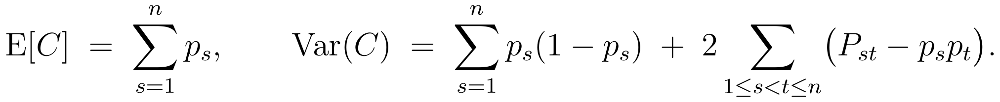
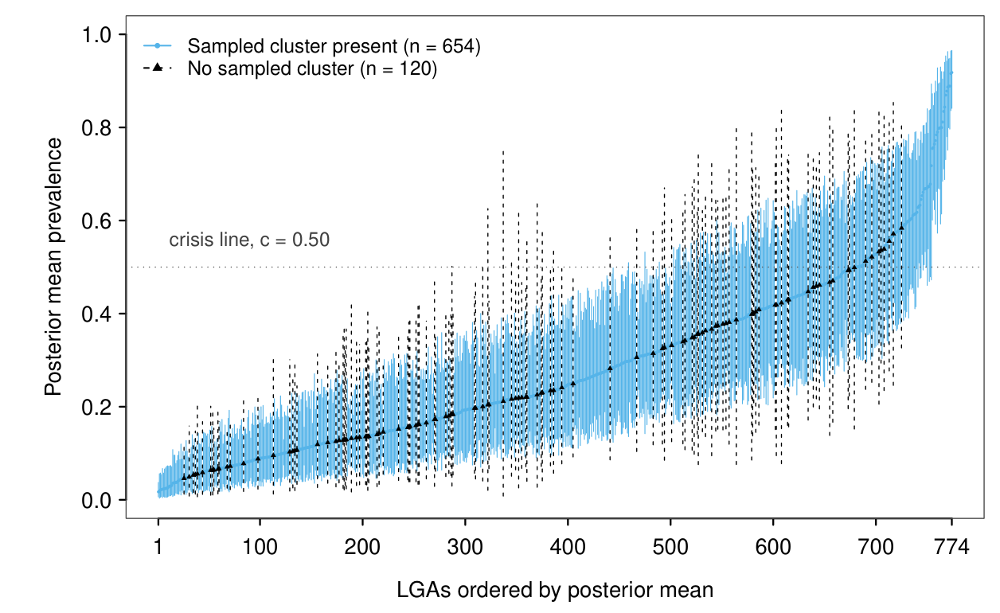
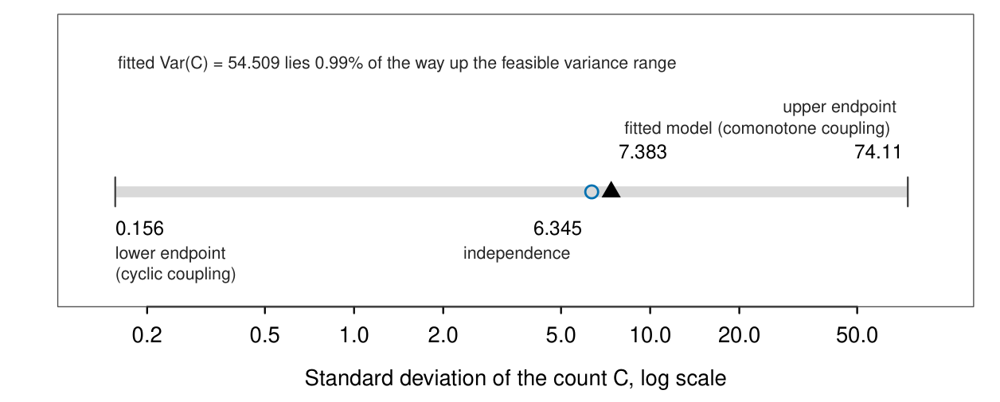
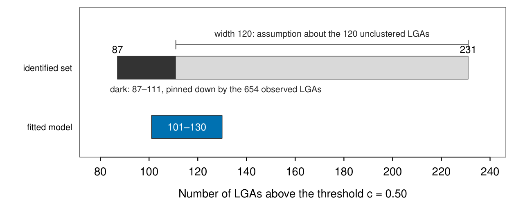
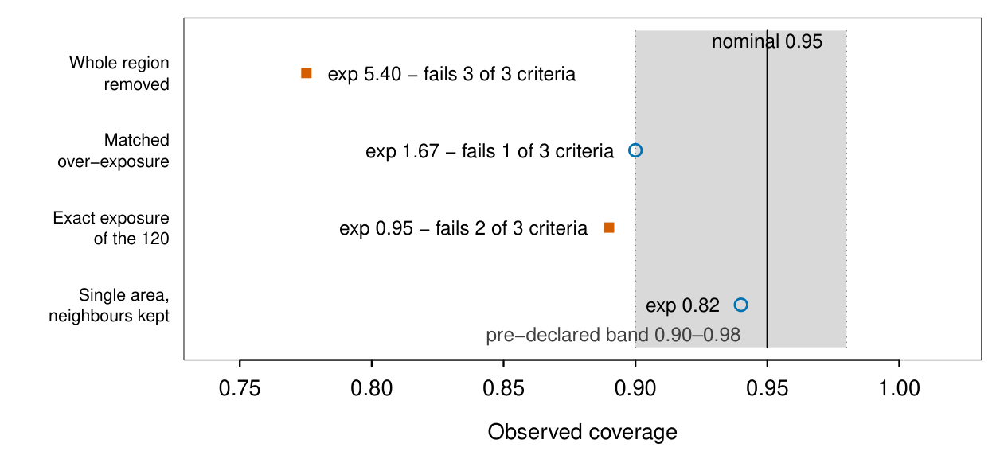

# Food insecurity in Nigeria — small-area estimation at LGA level

Bayesian small-area estimates of **severe household food insecurity** for Nigeria's 774 Local Government
Areas, from the 2024 Nigeria Demographic and Health Survey, fitted in R-INLA.

The question is not "what is the national rate" but **how many LGAs are above a crisis line, and how sure
can we be of that count** — a question that needs the *joint* posterior, and that a method reporting only
per-area estimates cannot answer.

📄 **Manuscript:** [`paper.pdf`](paper.pdf) · 🎬 **Two-minute walkthrough:**
[`ConferenceMaths-walkthrough-olufunmi.mp4`](ConferenceMaths-walkthrough-olufunmi.mp4)

---

## Findings

At a threshold of 50% of households severely food insecure (`hfs_sev ≥ 0.5`, all eight food-insecurity
items affirmed):

| | |
|---|---|
| National weighted prevalence | 29.1% (unweighted 27.74%) |
| State range | 4.6% (Niger) to 85.0% (Yobe), median 23.5% |
| Moran's I, severe measure | 0.204 (permutation p = 0.018) |
| Moran's I, moderate-or-severe | −0.012 (p = 0.427) |
| **LGAs above the line** | **115 of 774** (14.9%) |
| 95% credible interval for that count | **101 to 130**, posterior sd 7.383 |
| Independent variance term | 40.258 (sd 6.345) |
| **Pairwise (spatial) term** | **14.248** — ratio 0.354 to the independent term |
| Same ratio with an exchangeable area effect | 0.187 |
| LGAs decided above / below / undecided | 32 / 509 / **40 in the 0.40–0.60 band** |
| LGAs with no sampled cluster | 120 (15.5%), holding **11.04% of the population** |
| **Count the design cannot place** | **87 to 231**, of which 120 is assumption |
| Share of people in a crisis LGA | observed 13.72%, identified **10.63%–24.90%** |

**A method reporting only marginals would put the standard deviation at 6.345 instead of 7.383 — about 14%
too small.** Roughly half of the pairwise term is shared uncertainty in the coefficients and half is
geography: with an exchangeable rather than spatial area effect the ratio falls from 0.354 to 0.187.

## What the data alone can and cannot settle

Let $I_s(c) = \mathbf{1}\{\theta_s > c\}$ and $C(c) = \sum_{s=1}^{n} I_s(c)$. With marginals
$p_s = \Pr\{I_s(c)=1\}$ and pairwise probabilities $P_{st} = \Pr\{I_s(c)=1, I_t(c)=1\}$,



The mean is fixed by the marginals alone, because expectation is additive. The variance is not: it needs
the pairwise terms, which no set of area-by-area estimates reports.

The sharp bounds given the marginals only, with $S=\sum_s p_s$, $k=\lfloor S \rfloor$ and $f = S-k$:

$$
f(1-f) \le  \mathrm{Var}(C) \le  \sum_{s,t}\min(p_s,p_t) - S^2 .
$$

For this application that is $\mathrm{Var}(C) \in [0.0244,\ 5492.63]$, i.e.
$\mathrm{sd}(C) \in [0.156,\ 74.11]$. **The model's variance of 54.509 sits 0.99% of the way up its
own feasible range** — so the interval 101–130 is a property of the model's dependence structure, not
something the data determine.



*Posterior mean prevalence by LGA, ordered, with 95% intervals. Areas with no sampled cluster (dashed) are
drawn separately from those with at least one, because that distinction is the paper.*



*The feasible range of $\mathrm{Var}(C)$ given the marginals, on a log axis so the fitted value is not
flattered by the much larger upper bound.*

## What the design cannot place

120 of the 774 LGAs hold no sampled cluster. They are 15.5% of places but only 11.04% of people, so the
identified set is narrower for people than for places. Treating each unclustered area as contributing
either 0 or 1 gives an identified count of **87 to 231**: the observed 654 LGAs pin down 87–111, and the
remaining 120 of the 144-wide interval is assumption, not evidence. The model's 101–130 sits inside it.

This is a **posterior interval for the sample-analogue identified set**, not a frequentist confidence set;
the lower endpoint is itself computed from model-smoothed prevalences and is conceded as such.



*What the design allows (87–231, with 87–111 pinned down by the observed areas) against what the model
claims (101–130).*

## Calibration: are the intervals worth anything?

Four spatial holdout designs, with pass rules fixed **before** any fold was fitted, all reported whether
they passed or failed.

| Design | Exposure | Mean z | SD z | Coverage | Verdict |
|---|---|---|---|---|---|
| Whole region removed | 5.4 | −0.654 | 1.648 | **0.775** | fails all three |
| Single area, neighbours kept | 0.82 | −0.052 | 1.111 | **0.940** | passes all three |
| Matched over-exposure | 1.67 | −0.068 | 1.181 | 0.900 | fails on spread |
| **At the exposure the 120 actually face** | **0.95** | −0.058 | 1.178 | **0.890** | fails on spread and coverage |

*Exposure* is the mean number of a held-out area's neighbours that no fit ever sees. Coverage at the
exposure that matters is **0.890, not the nominal 0.95**. Widening unsampled-area intervals by
**k = 1.178** raises coverage to 0.940, validated out of fold (0.875, 1.000, 0.925, 0.975, 0.950).

Interpolation among sampled neighbours is calibrated; extrapolation to a region with no local observations
is not (in-sample correlation with direct estimates 0.975, single-area 0.768, whole-region 0.195). The
count interval is **not** validated by any of these tests, and the paper says so.



*Four designs against the nominal level and the pre-declared band. The points are not joined, because the
evidence does not support a coverage curve.*

## Model

Household-level binomial with a BYM2 spatial field and an IID cluster effect:

$$
\mathrm{logit}\,\Pr(Y_h = 1) = \mathbf{x}_h'\boldsymbol{\beta} + u_{s(h)} + v_{c(h)},
\qquad
u_s = \sigma_u(\sqrt{\phi}\,\tilde{u}_s + \sqrt{1-\phi}\,\epsilon_s),
$$

with $\tilde{u}$ an intrinsic CAR field on the queen-contiguity graph (774 nodes, 2,230 edges, one
connected component), $\epsilon$ IID, and $v$ an IID effect for the 1,380 survey clusters. Ten design
columns from eight household covariates; no area-level covariates in the primary model.

Posterior summaries: precision for the LGA field 0.904, **φ = 0.971 (0.902–0.997)** — the between-area
variation is almost entirely spatially structured, the opposite of what the state-level analysis found —
cluster precision 4.784, WAIC 37,942.17, mode status 0. Thirty are 20,000 joint draws; the BYM2 field is
read from prediction rows rather than reconstructed from the latent blocks.

## Reproducing

R 4.5.2 with R-INLA 25.10.19, `sf`, `spdep`; Python 3.14 with `pyreadstat`, `pandas`, `numpy`, `pyproj`.

```
python scripts/build_analysis_households.py   # analysis dataset (needs the licensed microdata)
python scripts/extract_fi_state.py            # direct state estimates
Rscript scripts/lga_assign.R                  # clusters -> LGAs
Rscript scripts/lga_dataset.R                 # population denominators, household merge
Rscript scripts/lga_model.R                   # the fit and the count functional (~35 min)
Rscript scripts/identif_bounds.R              # identification bounds (5 s, reads the saved draws)
Rscript scripts/theory_counts.R               # the four propositions, checked numerically
Rscript scripts/calibration_spatial.R         # design 1: whole region removed
Rscript scripts/calibration_lga_cv.R          # design 2: single areas, neighbours kept
Rscript scripts/calibration_matched_exposure.R
Rscript scripts/calibration_exact_exposure.R  # design 4: the 120 areas' own exposure
Rscript scripts/make_figures.R                # the four figures above
```

Every number in this file is produced by one of those scripts and stored as JSON under `data/derived/`.

## Repository map

| Path | Contents |
|---|---|
| `docs/manuscript/` | LaTeX sources of the paper; `paper.pdf` at the root is the built copy |
| `docs/theory.tex` | Four propositions with proofs, and a numerical table checking them |
| `data/derived/` | Area-level results as JSON/CSV — the artefacts behind every number above |
| `data/public/` | Boundaries and other redistributable inputs |
| `scripts/` | One script per stage, as listed above |
| `PLAN.md` | Phase-by-phase state, defect register, what remains unproven |
| `.agent/` | Ticket reports: what was asked, what was verified, what is still open |

## Data and licences

**Code is MIT. Results, documentation and write-ups are CC BY 4.0** — see `DATA_LICENSE.md`.

| Input | Source | Licence |
|---|---|---|
| NDHS 2024 microdata | [DHS Program](https://dhsprogram.com/) | DHS data-use agreement; **not redistributed here** |
| LGA and state boundaries | geoBoundaries | CC BY 4.0 |
| LGA population | COD-PS (NBS/UNFPA), 2020 projections | CC BY-IGO |

## Limitations, stated plainly

- **The survey design is not in the likelihood.** Weighted national prevalence is 29.10%, the fitted
  unweighted quantity 27.74%. The estimates describe the unweighted sample.
- **The count interval is not validated** by any of the four calibration designs.
- **No regional extrapolation.** A held-out region is predicted near 0.13–0.28 whatever the truth.
- **No calibrated map for the 120 unclustered areas**, and no way to score them: no truth exists for them.
- **LGA assignment** uses geoBoundaries polygons, not the survey's own boundaries; population denominators
  are 2020 projections from the 2006 census.
- **Area covariates are inert**: 19 of 20 coefficient intervals contain zero. Nightlights, travel time and
  livestock could not be interpolated from 1,380 sample points at all — the variables that most plausibly
  drive food insecurity are the ones this design cannot recover.
- The pairwise variance term is 14.2 ± ~1.7 (split-half 13.37 against 15.12 at 20,000 draws).

## Prior work, and what is claimed

Estimates for Nigeria exist at two levels: single-LGA cross-sectional surveys (Egor, Edo State; Akinyele,
Oyo State) and a mapping of household food insecurity across the 109 senatorial districts from the 2018/19
NLSS. What we did not find is a set of estimates for the **national set of 774 LGAs**, and any published
interval for the **count** of areas above a threshold. The claim is worded that way, and deliberately not
as "novel" or "first".

## Citing

```bibtex
@article{zachary2026bounds,
  author  = {Zachary, Jerry Bannister},
  title   = {Sharp bounds for the number of areas above a threshold, with a spatial
             cross-validation protocol: severe household food insecurity in Nigerian
             local government areas},
  year    = {2026},
  note    = {Manuscript under review, Journal of Mathematical Sciences (NMC Abuja)},
  url     = {https://github.com/batestguy/food-insecurity-nigeria}
}
```

## Status

The manuscript is complete — 28 pages, all seven required sections, twenty verified references — and is
being prepared for submission to the *Journal of Mathematical Sciences*, National Mathematical Centre
Abuja, Vol. 8 Issue 1 (deadline 30 December 2026). `PLAN.md` carries the phase-by-phase state and the
defect register; `.agent/` holds the per-ticket verification reports, including the two occasions where a
claim in an earlier draft was found to be wrong and corrected.
